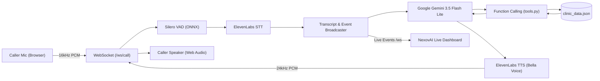

# CuraClinic — Autonomous Voice AI Appointment Infrastructure

An autonomous, full-duplex conversational voice agent and real-time companion web console for healthcare appointment scheduling. Built for the **Forward Deployed Engineer (FDE)** role at **NexovAI**.

The system enables callers to check doctor availability, book appointments, and cancel bookings via natural voice using **spoken phone-number identity** with **mandatory confirmation read-back**. The frontend is designed in the signature **NexovAI** dark futuristic aesthetic, auto-updating in real-time as the voice agent operates.

---

## 1. System Architecture & Pipeline



### End-to-End Pipeline Breakdown

1. **Audio Streaming & Transport**:
   - Direct bidirectional binary WebSocket (`/ws/call`) using `FastAPIWebsocketTransport`.
   - Browser captures mic audio via the Web Audio API, dynamically downsamples from hardware rate (typically 44.1kHz or 48kHz) to **16,000Hz 16-bit Mono PCM**, and streams binary chunks directly to the backend.
   - Eliminates third-party WebRTC/SIP room credit and token dependencies for maximum deployment autonomy and zero overhead.

2. **Voice Activity Detection (VAD)**:
   - Local **Silero VAD** running via ONNX Runtime inside Pipecat's `VADProcessor`.
   - Emits sub-millisecond start-of-speech and end-of-speech boundary frames, enabling natural caller interruption (barge-in) and clean audio slicing.

3. **Speech-to-Text (STT)**:
   - **ElevenLabs Real-time STT** transcribes spoken patient utterances with medical term and number accuracy.

4. **Conversational Intelligence & Reasoning (LLM)**:
   - **Google Gemini 3.5 Flash Lite** (`gemini-3.5-flash-lite`) via Google GenAI SDK.
   - Provides sub-1.6s response latency, robust structured function calling, and conversation state management.
   - Guardrailed with strict system instructions to keep interactions focused strictly on clinic administration.

5. **Text-to-Speech (TTS)**:
   - **ElevenLabs Neural TTS** using the high-clarity **Bella** voice (`EXAVITQu4vr4xnSDxMaL`).
   - Streams 24kHz synthesized audio frames back to the client over the same WebSocket, buffered and played through the browser's `AudioContext`.

6. **Data Storage & Function Calling**:
   - Lightweight, dependency-free JSON data store (`clinic_data.json`) backed by `database.py`.
   - Exposes three deterministic tools to Gemini:
     - `check_doctor_availability(doctor_name, date, specialty)`
     - `book_appointment(patient_phone, doctor_name, slot_time, slot_date)`
     - `cancel_appointment(patient_phone)`

7. **Live Real-time Dashboard**:
   - Secondary WebSocket channel (`/ws`) broadcasts transcripts and appointment updates in real time to the browser UI without page reloads.

---

## 2. Key Business & Conversational Guardrails

* **Phone-Number Only Identification**: No logins, accounts, or OTP passwords required. Patients are identified strictly by their spoken phone number.
* **Mandatory Phone Read-Back Confirmation**: Before executing any booking or cancellation, the agent **always reads back the phone number** to the caller to guarantee transcription accuracy (*"To confirm, I have your phone number as 98765-43210. Is that correct?"*). The tool is only called once the user affirms.
* **Clinical Boundary Protection**: The agent refuses to provide medical advice, diagnoses, or prescription recommendations, advising the caller to speak directly with a physician.
* **Emergency Protocol**: Any mention of life-threatening emergencies (e.g., chest pain, severe bleeding, difficulty breathing) immediately triggers an emergency redirect to dial 911 or visit the nearest ER.
* **Full-Duplex Multi-Turn Operations**: Callers can check multiple doctors, book a slot, and cancel existing bookings all within a single uninterrupted call session.

---

## 3. Project Structure

```text
clinic-voice-agent/
├── backend/
│   ├── main.py            # FastAPI app, WebSockets (/ws, /ws/call), static asset server
│   ├── bot.py             # Pipecat audio pipeline (VAD, STT, Gemini LLM, TTS, logging)
│   ├── tools.py           # Function calling tools for availability, booking, cancel
│   ├── database.py        # Clean JSON database manager
│   ├── clinic_data.json   # Seeded data (4 doctors, multiple slots, appointments)
│   ├── requirements.txt   # Python dependencies (Pipecat, FastAPI, Uvicorn, etc.)
│   └── venv/              # Python virtual environment
├── frontend/
│   ├── index.html         # NexovAI-themed HTML5 console & phone call modal
│   ├── style.css          # Glassmorphism, neon mint (#67fcc6) glows, responsive grid
│   └── app.js             # Web Audio API 16kHz PCM streaming & 24kHz playback
├── .env.example           # Example environment template
├── .gitignore             # Git ignore file
└── README.md              # Project documentation
```

---

## 4. Setup & Running

### Prerequisites
* **Python 3.10+** (Tested on Python 3.12)
* **Google Gemini API Key** (from [Google AI Studio](https://aistudio.google.com/))
* **ElevenLabs API Key** (from [ElevenLabs](https://elevenlabs.io/))

### 1. Configure Environment Variables
Create `backend/.env` (or copy from `.env.example`):
```env
# Gemini LLM Key (from Google AI Studio)
GEMINI_API_KEY=your_gemini_api_key_here

# ElevenLabs STT & TTS (from https://elevenlabs.io/)
ELEVENLABS_API_KEY=your_elevenlabs_api_key_here
ELEVENLABS_VOICE_ID=EXAVITQu4vr4xnSDxMaL

# Server Port
PORT=8000
```

### 2. Install Dependencies & Run Server
```bash
# Navigate to the project root
cd clinic-voice-agent

# Create virtual environment (if not already created)
python3 -m venv backend/venv
source backend/venv/bin/activate

# Install dependencies
pip install -r backend/requirements.txt

# Start the unified backend & frontend server
python backend/main.py
```

Open **`http://localhost:8000`** in your browser.

---

## 5. Walkthrough Demo Flow (For Video Recording)

1. **Dashboard Overview**:
   - The page loads with active physicians (Dr. Sarah Jenkins, Dr. Rajesh Sharma, Dr. Emily Watson, Dr. Michael Chang) and existing appointments in the live ledger.
2. **Launch Call**:
   - Click the glowing **"Start Voice Agent"** button. The futuristic terminal phone modal opens.
   - Allow browser microphone access.
3. **Agent Greeting**:
   - Cura immediately greets: *"Hello! Welcome to CuraClinic appointment desk. How may I assist you today?"*
4. **Availability Inquiry**:
   - Say: *"Can you check availability for Dr. Sarah Jenkins tomorrow?"*
   - Cura queries `check_doctor_availability` and speaks back open slots (e.g., 09:00 AM, 10:30 AM).
5. **Booking with Confirmation**:
   - Say: *"Please book the 10:30 AM slot. My phone number is 98765-43210."*
   - Cura reads back the number: *"I have your phone number as 98765-43210. Is that correct?"*
   - Say: *"Yes, that's correct."*
   - Cura confirms the booking. Notice the **Live Appointments Stream** on the dashboard immediately displays the new booking!
6. **Cancellation**:
   - Say: *"I also need to cancel an appointment under phone number 555-0199."*
   - Cura reads back: *"To confirm, you want to cancel the appointment for 555-0199, is that correct?"*
   - Say: *"Yes."*
   - Cura cancels the slot, and the dashboard updates in real time.
7. **End Call**:
   - Click the red hangup button or say goodbye.

---

## 6. Live Terminal Observability

Every conversational turn is logged directly to the server terminal with clear attribution:
```text
🗣️  [CALLER]: Can you check availability for Dr. Sarah Jenkins tomorrow?
🤖 [CURA ASSISTANT]: Dr. Sarah Jenkins has available slots tomorrow at 09:00 AM and 10:30 AM. Would you like me to book one of these for you?
🗣️  [CALLER]: Let's book the 10:30 AM slot. My phone is 98765 43210.
🤖 [CURA ASSISTANT]: I have your phone number as 98765-43210. Can you confirm that this is correct before I complete the booking?
🗣️  [CALLER]: Yes that is correct.
🤖 [CURA ASSISTANT]: You're all set! I have booked your appointment with Dr. Sarah Jenkins for tomorrow at 10:30 AM.
```

---

## 7. Submission Pipeline Description

*(Copy this text into the assignment Google Form submission)*

> "The voice pipeline is built with Pipecat and FastAPI in Python, utilizing direct bidirectional WebSockets for low-latency full-duplex PCM audio streaming without external room dependencies. In the browser, raw microphone audio is downsampled to 16kHz 16-bit PCM via the Web Audio API and streamed to the server. The audio passes through a local Silero VAD (ONNX) pipeline processor for sub-millisecond speech boundary detection and barge-in handling, followed by ElevenLabs Real-time STT for speech transcription. The transcribed text is ingested by Google Gemini 3.5 Flash Lite (`gemini-3.5-flash-lite`), operating under strict domain guardrails that enforce telephone-only identity, conversational scope limits, emergency 911 redirects, and mandatory phone number read-back confirmation. Gemini triggers deterministic function calling against a lightweight JSON store (`clinic_data.json`) to check slot availability, book appointments, and cancel bookings. Assistant responses are synthesized into natural 24kHz audio via ElevenLabs TTS (Bella voice) and streamed back over the WebSocket for immediate client playback. Concurrently, a custom frame broadcaster pushes real-time transcripts and state mutations over a secondary WebSocket to auto-update the NexovAI-themed HTML5/CSS3 companion dashboard in real time."
