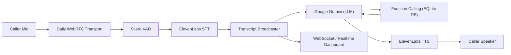

# CuraClinic — Voice AI Doctor Appointment Assistant

An autonomous, real-time voice agent and companion web dashboard for booking and managing clinic appointments over natural voice. Built for the **Forward Deployed Engineer (FDE)** role.

---

## 1. System Architecture & Pipeline



### Pipeline Details
* **Transport**: Daily.co WebRTC for ultra-low latency real-time bidirectional audio streaming.
* **VAD (Voice Activity Detection)**: Silero VAD running locally to cleanly detect speech start/stop and support seamless interruption.
* **STT (Speech-to-Text)**: ElevenLabs Speech-to-Text service for high-accuracy audio transcription.
* **LLM (Reasoning & Function Calling)**: **Google Gemini 2.5 Flash** (`gemini-2.5-flash`), providing fast latency, structured function calling, and empathetic conversational flow.
* **TTS (Text-to-Speech)**: ElevenLabs Text-to-Speech with low-latency streaming audio.
* **Database & Tools**: SQLite database backing three core functions:
  1. `check_doctor_availability(doctor_name, date, specialty)`
  2. `book_appointment(patient_phone, doctor_name, slot_time, slot_date)`
  3. `cancel_appointment(patient_phone)`

### Conversational Rules Built-in
1. **Phone-Number Only Identification**: No logins, passwords, or OTPs. The caller is identified solely by their spoken phone number.
2. **Mandatory Confirmation Read-Back**: Before executing any appointment booking or cancellation, the agent **reads back the phone number** to the caller to confirm accuracy (*"To confirm, I have your phone number as 98765-43210. Is that correct?"*).
3. **End-to-End Single Session**: Callers can check availability, book, and cancel within a single call.

---

## 2. Project Structure

```text
clinic-voice-agent/
├── backend/
│   ├── main.py            # FastAPI server, WebRTC room lifecycle, WebSocket broadcaster
│   ├── bot.py             # Pipecat pipeline (Daily + Silero VAD + ElevenLabs + Gemini)
│   ├── tools.py           # Core tools implementation (availability, booking, cancel)
│   ├── database.py        # SQLite database schema, seeding, and queries
│   └── requirements.txt   # Python dependencies
├── frontend/
│   ├── src/
│   │   ├── components/
│   │   │   ├── PhoneCallModal.tsx    # Phone-style call screen popup with waveform & transcript
│   │   │   ├── DoctorsList.tsx       # Live physician cards & available slot badges
│   │   │   └── AppointmentsList.tsx  # Live appointments registry with status
│   │   ├── App.tsx                   # Main dashboard & WebSocket listener
│   │   └── types.ts                  # Shared data interfaces
│   ├── package.json
│   └── vite.config.ts
├── .env.example
├── .gitignore
└── README.md
```

---

## 3. Quick Start Guide

### Prerequisites
* Python 3.10+
* Node.js v18+ & npm
* API Keys:
  * Google Gemini API Key: [Google AI Studio](https://aistudio.google.com/)
  * ElevenLabs API Key: [ElevenLabs](https://elevenlabs.io/)
  * Daily.co API Key: [Daily.co](https://dashboard.daily.co/)

### 1. Clone & Configure Environment
```bash
git clone https://github.com/VenuTeja22/clinic-voice-agent.git
cd clinic-voice-agent

# Create your .env file
cp .env.example backend/.env
```

Open `backend/.env` and paste your keys:
```env
GEMINI_API_KEY=your_gemini_api_key
ELEVENLABS_API_KEY=your_elevenlabs_api_key
ELEVENLABS_VOICE_ID=21m00Tcm4TlvDq8ikWAM
DAILY_API_KEY=your_daily_api_key
PORT=8000
```

### 2. Start Backend Server
```bash
cd backend
python3 -m venv venv
source venv/bin/activate
pip install -r requirements.txt
python main.py
```
*Backend runs at `http://localhost:8000` with WebSocket on `/ws`.*

### 3. Start Frontend Dashboard
In a new terminal window:
```bash
cd frontend
npm install
npm run dev
```
*Frontend will open at `http://localhost:3000`.*

---

## 4. Testing the Full Flow (Demo Video Script)

1. Open the dashboard at `http://localhost:3000`. You will see the list of doctors, available slots, and existing appointments.
2. Click **Start Voice Call**. A phone-style calling screen appears.
3. Allow browser microphone access. Once connected, the agent greets you:
   * *"Hello! Welcome to CuraClinic appointment desk. How may I assist you today?"*
4. Say: *"Hi, can I check doctor availability for cardiology tomorrow?"*
   * The agent will call `check_doctor_availability` and read out open slots for Dr. Sarah Jenkins.
5. Say: *"I'd like to book the 10:30 AM slot. My phone number is 98765-43210."*
6. **Confirmation Step**: The agent reads the number back:
   * *"I have your phone number as 98765-43210. Is that correct?"*
7. Say: *"Yes, that is correct."*
8. The agent books the appointment and confirms. The dashboard behind the phone modal **instantly reflects the newly booked appointment in real time**.

---

## 5. Pipeline Description (For Submission Form)

> "The voice pipeline is built with Pipecat in Python, using Daily.co WebRTC for low-latency bidirectional browser audio. Caller audio passes through local Silero VAD to detect speech boundaries, and is streamed into ElevenLabs STT for speech-to-text transcription. The transcribed text is ingested by Google Gemini 2.5 Flash, configured with system prompts enforcing telephone-only identity and mandatory number confirmation. Gemini performs structured function calling against an SQLite database (`check_doctor_availability`, `book_appointment`, `cancel_appointment`). Assistant text is synthesized into natural speech via ElevenLabs TTS and streamed back to the caller's audio output. Concurrently, a custom frame broadcaster pushes real-time transcripts and database mutation events across WebSockets to dynamically refresh the React frontend dashboard."
