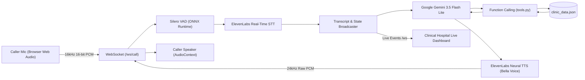

# NexovCare Hospital — Autonomous Voice AI Doctor Appointment Assistant

The system enables callers to check specialist availability, book outpatient consultations, and manage cancellations via natural voice using **spoken phone-number identity** with **mandatory confirmation read-back**. The frontend is engineered with an authentic **Clinical Hospital Theme**, auto-updating instantaneously via WebSockets as the voice assistant operates.

---

## 1. System Architecture & Pipeline



### End-to-End Pipeline Breakdown

1. **Audio Streaming & Full-Duplex Transport**:
   - Direct bidirectional binary WebSocket (`/ws/call`) using Pipecat's `FastAPIWebsocketTransport`.
   - The browser captures mic audio via the Web Audio API, downsamples from native hardware rates (44.1kHz / 48kHz) to **16,000Hz 16-bit Mono PCM**, and streams binary chunks directly to the backend.
   - Eliminates third-party WebRTC/SIP room credit and token dependencies for maximum deployment autonomy and minimal latency.

2. **Voice Activity Detection (VAD)**:
   - Local **Silero VAD** running via ONNX Runtime inside Pipecat's `VADProcessor(vad_analyzer=vad)`.
   - Detects sub-millisecond start-of-speech and end-of-speech frame boundaries, enabling natural caller interruption (barge-in) and accurate audio chunking.

3. **Speech-to-Text (STT)**:
   - **ElevenLabs Real-time STT** transcribes spoken patient utterances with high accuracy for medical names and spoken digit sequences.

4. **Conversational Intelligence & Reasoning (LLM)**:
   - **Google Gemini 3.5 Flash Lite** (`gemini-3.5-flash-lite`) via Google GenAI SDK.
   - Low-latency inference (<1.5s), strict system guardrails, and deterministic tool function calling.

5. **Text-to-Speech (TTS)**:
   - **ElevenLabs Neural TTS** using the high-clarity **Bella** voice (`EXAVITQu4vr4xnSDxMaL`).
   - Streams 24kHz synthesized audio frames back to the client over the same WebSocket, buffered and played through the browser's `AudioContext`.

6. **Data Storage & Deterministic Function Calling**:
   - Dependency-free JSON data store (`clinic_data.json`) backed by `database.py`.
   - Exposes three deterministic tools registered with Pipecat:
     - `check_doctor_availability(doctor_name, date, specialty)`
     - `book_appointment(patient_phone, doctor_name, slot_time, slot_date)`
     - `cancel_appointment(patient_phone, doctor_name, slot_time, slot_date)`

7. **Live Real-Time Dashboard**:
   - Secondary WebSocket channel (`/ws`) broadcasts transcripts and appointment state mutations in real time to the browser UI without page reloads.

---


## 2. Key Business Rules & Conversational Guardrails

* **Phone-Number Only Identification**: No accounts, logins, or OTP passwords required. Patients are identified strictly by their spoken phone number.
* **Mandatory Phone Read-Back Confirmation**: Before executing any booking or cancellation, the agent **always reads back the phone number** to the caller to guarantee transcription accuracy (*"To confirm, I have your phone number as 98765-43210. Is that correct?"*).
* **Multi-Appointment Disambiguation**: If a patient has multiple active bookings under the same phone number and requests cancellation, the agent reads out all matching appointments and prompts the caller to select which specific consultation to cancel.
* **Dynamic Rolling Date Auto-Seeding**: The application automatically seeds and maintains slots for **Today** and **Tomorrow** dynamically on any day the app runs, without overwriting past patient bookings.
* **Real-Time Past-Slot Protection**: Slots earlier than the current local clock time today are automatically filtered out and blocked from booking.
* **Clinical Boundary Protection**: The agent strictly declines to provide medical advice or diagnoses, steering callers to book an outpatient consultation.
* **Emergency Protocol**: Any mention of acute symptoms (chest pain, severe bleeding, difficulty breathing) triggers an immediate emergency redirect to dial 108/911.

---

## 3. Project Structure

```text
clinic-voice-agent/
├── backend/
│   ├── main.py            # FastAPI app, WebSockets (/ws, /ws/call), static asset server
│   ├── bot.py             # Pipecat audio pipeline (Silero VAD, STT, Gemini LLM, TTS)
│   ├── tools.py           # Function calling tools for availability, booking, cancel
│   ├── database.py        # Clean JSON database manager & rolling date seeder
│   ├── clinic_data.json   # Seeded data (6 doctors, multiple slots, appointments)
│   ├── requirements.txt   # Python dependencies (Pipecat, FastAPI, Uvicorn, etc.)
│   └── venv/              # Python virtual environment
├── frontend/
│   ├── index.html         # Clinical hospital portal & telehealth call modal
│   ├── style.css          # Professional medical design system & responsive layout
│   └── app.js             # Web Audio API 16kHz PCM streaming & 24kHz playback
├── .env.example           # Example environment template
├── .gitignore             # Git ignore file
└── README.md              # Project documentation
```

---

## 4. Setup & Running

### Prerequisites
* **Python 3.10+** (Tested on Python 3.12)
* **Google Gemini API Key** (from [Google AI Studio](https://aistudio.google.com/))
* **ElevenLabs API Key** (from [ElevenLabs](https://elevenlabs.io/))

### 1. Configure Environment Variables
Create `backend/.env` (or copy from `.env.example`):
```env
# Gemini LLM Key (from Google AI Studio)
GEMINI_API_KEY=your_gemini_api_key_here

# ElevenLabs STT & TTS (from https://elevenlabs.io/)
ELEVENLABS_API_KEY=your_elevenlabs_api_key_here
ELEVENLABS_VOICE_ID=EXAVITQu4vr4xnSDxMaL

# Server Port
PORT=8000
```

### 2. Install Dependencies & Run Server
```bash
# Navigate to the project root
cd clinic-voice-agent

# Create virtual environment (if not already created)
python3 -m venv backend/venv
source backend/venv/bin/activate

# Install dependencies
pip install -r backend/requirements.txt

# Start the unified backend & frontend server
python backend/main.py
```

Open **`http://localhost:8000`** in your browser.

---

## 5. Demo Walkthrough Flow 

1. **Dashboard Overview**:
   - Navigate to `http://localhost:8000`. The hospital portal displays the 24/7 emergency ribbon, active clinical specialists, real-time Today & Tomorrow schedule grid, and the live Patient Appointment Ledger.
2. **Launch Call**:
   - Click **"Call Voice Desk"**. The telehealth smartphone screen opens.
   - Allow browser microphone access.
3. **Agent Greeting**:
   - Cura immediately greets: *"Hello! Welcome to NexovCare Hospital appointment desk. How may I assist you today?"*
4. **Availability Inquiry**:
   - Say: *"Can you check availability for Dr. Sarah Jenkins tomorrow?"*
   - Cura invokes `check_doctor_availability` and speaks back open slots (e.g., 09:00 AM, 10:30 AM).
5. **Booking with Confirmation**:
   - Say: *"Please book the 10:30 AM slot. My phone number is 98765-43210."*
   - Cura reads back the number: *"I have your phone number as 9 8 7, 6 5 4, 3 2 1 0. Is that correct?"*
   - Say: *"Yes, that is correct."*
   - Cura confirms the booking. The **Patient Appointment Ledger** on the dashboard immediately updates in real time with the new booking!
6. **Cancellation**:
   - Say: *"I also need to cancel an appointment under phone number 555-0199."*
   - Cura confirms: *"To confirm, you want to cancel the appointment under 5 5 5, 0 1 9 9, is that correct?"*
   - Say: *"Yes."*
   - Cura cancels the slot, and the dashboard reflects the cancellation instantly.
7. **End Call**:
   - Click the red **End Call** button.

---

## 6. Live Terminal Observability

Every conversational turn is logged directly to the server terminal with clear speaker attribution:
```text
🗣️  [CALLER]: Can you check availability for Dr. Sarah Jenkins tomorrow?
🤖 [CURA ASSISTANT]: Dr. Sarah Jenkins has available slots tomorrow at 09:00 AM and 10:30 AM. Would you like me to book one of these for you?
🗣️  [CALLER]: Let's book the 10:30 AM slot. My phone is 98765 43210.
🤖 [CURA ASSISTANT]: I have your phone number as 98765-43210. Can you confirm that this is correct before I complete the booking?
🗣️  [CALLER]: Yes that is correct.
🤖 [CURA ASSISTANT]: You're all set! I have booked your appointment with Dr. Sarah Jenkins for tomorrow at 10:30 AM.
```
---
